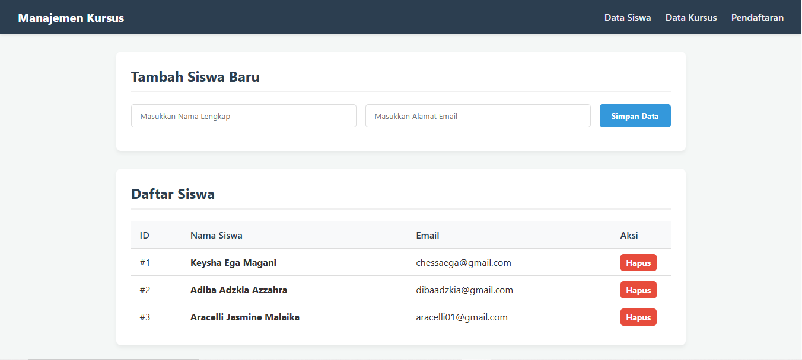
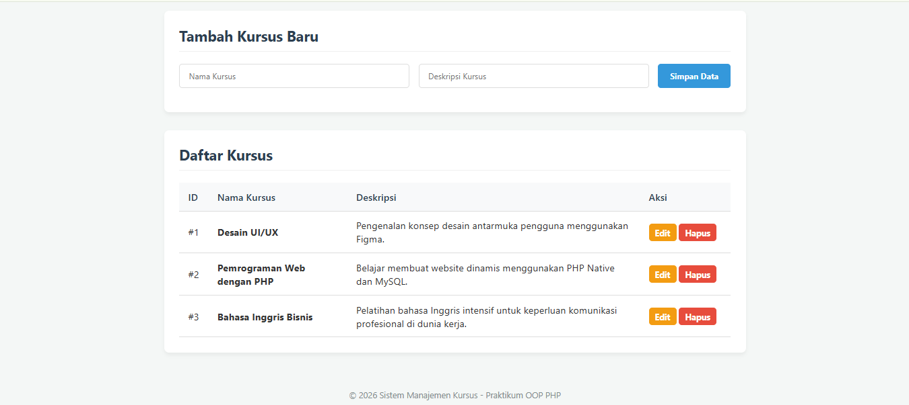
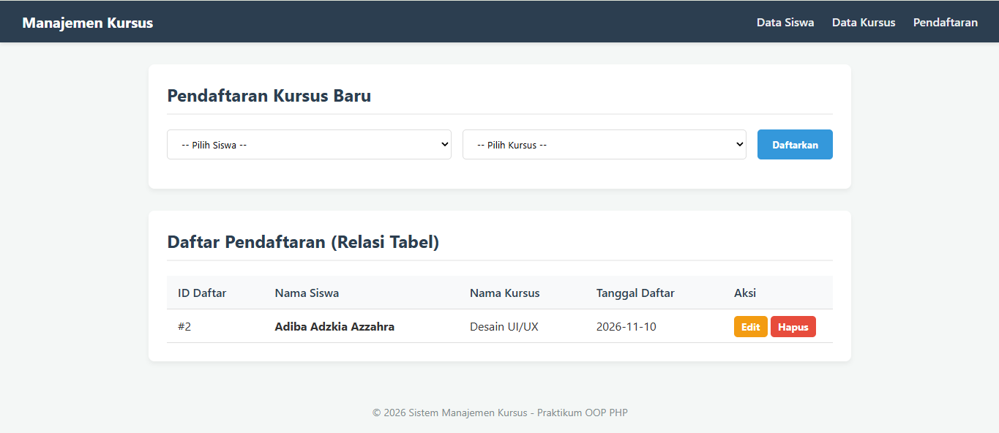

# TP7DPB02526C1- Sistem Manajemen Kursus

Aplikasi web sederhana berbasis **PHP Native** menggunakan pendekatan **Object-Oriented Programming (OOP)** dan **PDO (PHP Data Objects)** dengan prepared statements untuk mengelola data siswa, kursus, dan pendaftaran.

---

## 📌 Deskripsi & Tema Website
Website ini bertema **Sistem Manajemen Kursus** yang digunakan untuk mengelola data pendaftaran siswa pada berbagai pilihan kursus yang tersedia. 

---

## 🗄️ Penjelasan Database (`db_course`)
Database aplikasi ini terdiri dari 3 entitas/tabel yang saling terhubung:

1. **`students`**
   - `id` (INT, Primary Key, Auto Increment)
   - `name` (VARCHAR) - Nama lengkap siswa
   - `email` (VARCHAR, Unique) - Alamat email siswa

2. **`courses`**
   - `id` (INT, Primary Key, Auto Increment)
   - `title` (VARCHAR) - Nama/judul kursus
   - `description` (TEXT) - Deskripsi penjelasan kursus

3. **`enrollments` (Tabel Relasi)**
   - `id` (INT, Primary Key, Auto Increment)
   - `student_id` (INT, Foreign Key -> `students.id`)
   - `course_id` (INT, Foreign Key -> `courses.id`)
   - `enroll_date` (DATE) - Tanggal pendaftaran otomatis

---

## 🏗️ Alur Kode & Struktur Proyek (Flow Code)

Aplikasi dibangun menggunakan struktur modular berorientasi objek:

- **`config/db.php`**: Mengatur koneksi ke MySQL menggunakan PDO.
- **`class/`**:
  - `Student.php`: Menangani operasi CRUD tabel siswa.
  - `Course.php`: Menangani operasi CRUD tabel kursus.
  - `Enrollment.php`: Menangani operasi CRUD relasi pendaftaran (menggabungkan data siswa & kursus via JOIN query).
- **`view/`**:
  - `header.php` & `footer.php`: Komponen tampilan HTML/UI yang modular.
  - `students.php`: Antarmuka manajemen siswa.
  - `courses.php`: Antarmuka manajemen kursus.
  - `enrollments.php`: Antarmuka pendaftaran kursus (relasi).
- **`index.php`**: Entry point aplikasi yang mengarahkan user ke halaman utama.
- **`style.css`**: Berisi aturan styling antarmuka (dashboard layout).

---
 
## 📸 Dokumentasi Pengujian (Screenshot CRUD)

### 1. Data Siswa

### 2. Data Kursus

### 3. Pendaftaran Kursus (Relasi)
 